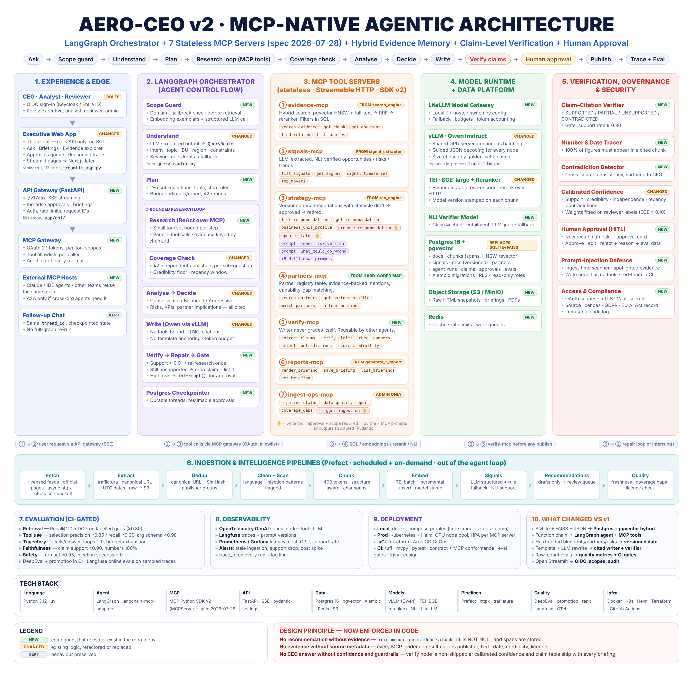

# AERO-CEO

Strategic intelligence agent for Airbus SE. It turns public information into evidence-backed
executive recommendations for defence and aerospace decisions.

> **v2 is in progress on this branch.** It rebuilds AERO-CEO as an MCP-native agentic system: stateless
> MCP tool servers, a LangGraph orchestrator, hybrid evidence retrieval, claim-level verification and
> human approval. See the [architecture](docs/architecture.md), the [progress tracker](docs/v2-progress.md)
> and the [decision records](docs/adr/). The v1 demo (`app/`, `scripts/*.sh`) is frozen and still runs.



**Design principle, enforced in code:** no recommendation without evidence · no evidence without
source metadata · no CEO answer without confidence and guardrails.

## v2 quick start (single machine, SQLite)

```bash
python -m venv .venv && source .venv/bin/activate
pip install -e ".[mcp,extract,local-models,dev]"     # local-models = sentence-transformers + torch
cp .env.example .env                                 # defaults: SQLite + BGE-large in-process

aero db migrate && aero seed sources
aero ingest v1 data/aero_ceo.sqlite                  # import the v1 corpus (read-only; strips v1 templates)
aero ingest official --limit 40                      # and/or collect fresh evidence
aero ingest news --limit 200
aero search "Which partner could help Airbus in Spain for SIRTAP?"
pytest                                               # 122 tests, no network, no GPU
```

## MCP servers

| Server | Tools | Also |
|---|---|---|
| `evidence` | `search_evidence`, `get_chunk`, `get_document`, `find_related`, `list_sources`, `list_topics`, `evidence_stats` | resources `evidence://chunk/{id}`, `evidence://document/{id}` |
| `signals` | `list_signals`, `get_signal`, `signal_timeseries`, `top_movers` | every signal quotes its sentence |
| `strategy` | `list_recommendations`, `get_recommendation`, `business_unit_profile`, `risk_checklist` (+ `propose_recommendation`, `update_recommendation_status` with `AERO_STRATEGY_ALLOW_WRITES=true`) | 7 drill-down **prompts** |
| `partners` | `search_partners`, `get_partner_profile`, `match_partners`, `partner_mentions` | |
| `all` | every tool above on one server | for local use and the orchestrator |

```bash
aero signals extract                 # rule:v1-strict signals with quoted evidence
aero seed recommendations            # v1 blueprints as drafts + auto-linked candidate evidence
aero rec list && aero rec show 1     # human review; approval needs 2+ independent publishers:
aero rec approve 1 --reviewer "Keyur" --reason "evidence checked"
```

## Use the servers from an MCP host

stdio (Claude Desktop, MCP Inspector):

```json
{ "mcpServers": { "aero": {
    "command": "/abs/path/.venv/bin/aero", "args": ["serve", "all", "--stdio"],
    "cwd": "/abs/path/aero-ceo" } } }
```

HTTP (stateless Streamable HTTP, protocol 2026-07-28): `aero serve evidence` serves `/mcp` and `/healthz`
on `AERO_MCP_HOST:AERO_MCP_PORT`. Set `AERO_MCP_ALLOWED_HOSTS` and `AERO_MCP_BEARER_TOKEN` when the
server is reachable from outside localhost.


## Full stack (Postgres + pgvector + TEI)

```bash
cp .env.example .env    # set POSTGRES_PASSWORD and AERO_MCP_BEARER_TOKEN
docker compose up -d --build
docker compose --profile ingest run --rm worker ingest news --limit 50
```

## Measuring retrieval quality

```bash
aero eval pool                    # top-20 candidates per seed query -> evals/datasets/retrieval_pool.jsonl
# set "grade": 0 / 1 / 2 on each candidate, then:
aero eval labels && aero eval retrieval --min-recall 0.80
```

## Repository map

| Path | What |
|---|---|
| `src/aero/` | v2 package (see [ADR 0005](docs/adr/0005-package-layout.md)) |
| `seeds/` | taxonomy, sources and licences, partners, risks, v1 recommendations, drill-down prompts, signal rules |
| `evals/datasets/` | golden-question and retrieval-query seeds; qrels once labelled |
| `tests/` | unit, storage contract (SQLite + Postgres), MCP (in-process, HTTP, stdio), CLI end-to-end |
| `app/`, `scripts/*.sh`, `requirements.txt` | v1, frozen; removed when v2 reaches parity (phase 3) |

## v1 (frozen)

The original pipeline and Streamlit demo. Run with `bash scripts/rebuild_demo.sh` and `bash scripts/run_streamlit.sh` (`pip install -r requirements.txt`).


