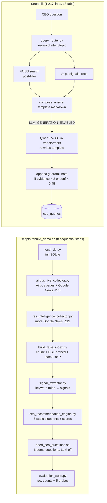
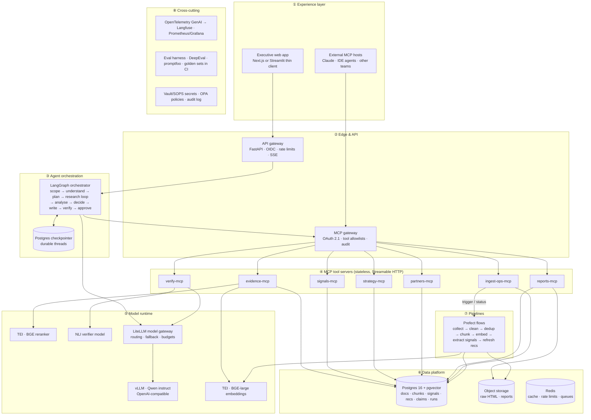
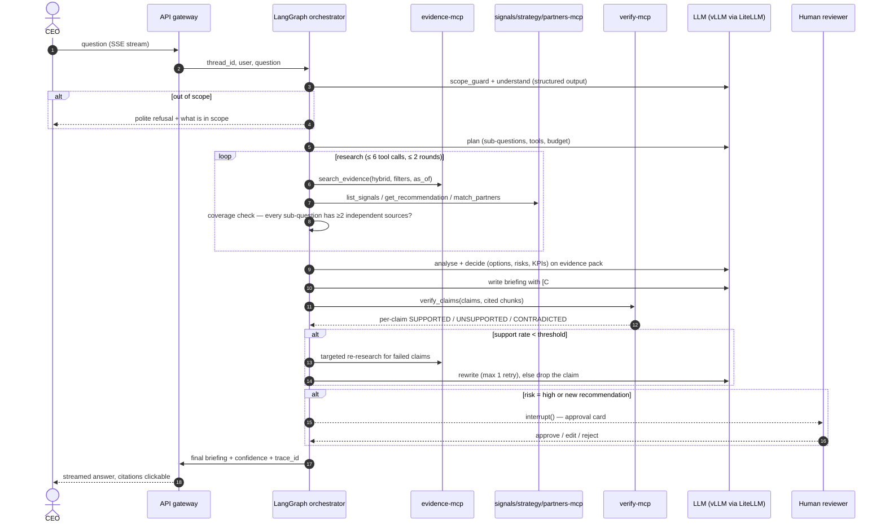
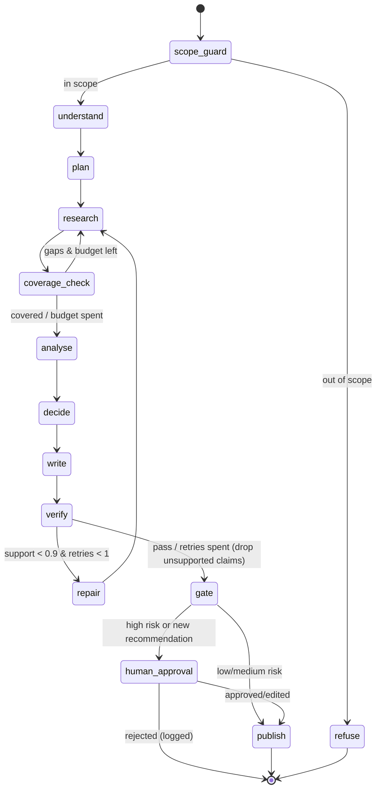
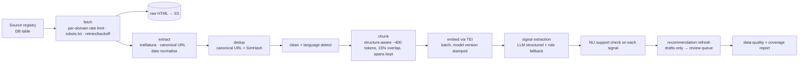

# AERO-CEO v2 — MCP-Native Agentic Architecture

**From a RAG demo pipeline to a deployable, MCP-based strategic intelligence system**

| | |
|---|---|
| Repository analysed | `github.com/keyurck7/aero-ceo` (commit `6b6caa3`, ~6.8k lines Python) |
| Document date | 2 November 2026 |
| Target protocol | MCP spec **2026-07-28** (stateless), MCP Python SDK **v2** |
| Author | Keyur Chaudhari |

> **Implementation notes (2026-11-07).** Two decisions refine this plan: plain-SQL migrations plus a SQLite adapter instead of SQLAlchemy/Alembic ([ADR 0002](adr/0002-postgres-pgvector-and-sql-migrations.md)), and one `aero` package with extras instead of a multi-package layout ([ADR 0005](adr/0005-package-layout.md)). Status per phase: [v2-progress.md](v2-progress.md).

---

## Table of contents

1. [Executive summary](#1-executive-summary)
2. [What the repository actually does today](#2-what-the-repository-actually-does-today)
3. [Findings: defects and production blockers in the current code](#3-findings-defects-and-production-blockers)
4. [Target architecture (v2)](#4-target-architecture-v2)
5. [MCP server catalogue — every tool, resource and prompt](#5-mcp-server-catalogue)
6. [The agent: LangGraph orchestrator design](#6-the-agent-langgraph-orchestrator)
7. [Data platform: from SQLite + FAISS to Postgres + pgvector](#7-data-platform)
8. [Ingestion and intelligence pipelines](#8-ingestion-and-intelligence-pipelines)
9. [Model runtime](#9-model-runtime)
10. [Verification, guardrails and human approval](#10-verification-guardrails-and-human-approval)
11. [Security and compliance](#11-security-and-compliance)
12. [Observability](#12-observability)
13. [Evaluation framework](#13-evaluation-framework)
14. [Deployment and operations](#14-deployment-and-operations)
15. [File-by-file migration map (every file in the repo)](#15-file-by-file-migration-map)
16. [New repository layout](#16-new-repository-layout)
17. [Development needs: stack, versions, infrastructure, skills](#17-development-needs)
18. [Phased delivery roadmap](#18-phased-delivery-roadmap)
19. [Definition of done (production readiness checklist)](#19-definition-of-done)
20. [Open decisions and risks](#20-open-decisions-and-risks)

---

## 1. Executive summary

AERO-CEO today is a **well-structured, single-process RAG pipeline**: collectors write news into SQLite, a FAISS index is built over chunks, keyword rules extract "signals", six hand-written recommendation blueprints are scored, and a Streamlit app answers CEO questions by retrieving chunks and optionally asking a local Qwen model to rewrite a template answer.

The architecture poster shows a LangGraph agent with a scope guard, claim–citation verifier, contradiction detector, LLM judge, human approval and trace logging. **None of those exist in the pushed code.** `requirements.txt` contains no LangGraph or LangChain, `app/api/` is empty, and there is no verifier, contradiction detector or approval workflow anywhere in `app/`. Either that work is local and unpushed, or the poster is the plan. This document treats the poster as the intent and the repository as the baseline.

The v2 redesign changes five things:

1. **Capabilities become MCP servers.** Evidence search, signals, recommendations, partners, verification, reports and ingestion-ops become seven independently deployable, stateless MCP servers. Any MCP client — the orchestrator, Claude, an IDE, another team's agent — can use them with the same auth and audit.
2. **The agent becomes a real agent.** A LangGraph state machine plans, calls MCP tools in a bounded research loop, writes, **verifies every claim against cited chunks**, re-researches on failure, and pauses for human approval on high-risk output. Durable checkpoints replace the current "save a markdown answer to SQLite" pattern.
3. **Hard-coded knowledge becomes data.** `RECOMMENDATION_BLUEPRINTS`, `PARTNER_CAPABILITY_MAP`, `RISK_LIBRARY`, `OPTION_LIBRARY`, `INTENT_RULES` and the signal rules move into versioned database tables, or are replaced by LLM structured extraction with the rules kept as a fallback.
4. **The data layer becomes production-grade.** Postgres + pgvector with hybrid (vector + full-text) search and a reranker replaces SQLite + flat FAISS + a JSON metadata file. The `docker-compose.yml` already starts pgvector; the code never uses it.
5. **Quality becomes measurable.** The current evaluation counts rows and checks whether query words appear in results; it reports 14/14 "Production-demo ready". v2 adds labelled retrieval qrels, claim-level faithfulness, trajectory metrics, an LLM judge calibrated against human labels, prompt-injection red-teaming and CI gates.

The design principle on the poster stays and is now **enforced in code**, not just stated:

> No recommendation without evidence. No evidence without source metadata. No CEO answer without confidence and guardrails.

---

## 2. What the repository actually does today

### 2.1 Runtime flow (as implemented)



### 2.2 Component inventory

| Area | Files | What it does | Character |
|---|---|---|---|
| Storage | `app/db/local_db.py`, `chat_schema.py`, `schema.sql` | SQLite tables: sources, documents, chunks, signals, recommendations, recommendation_evidence, analysis_runs, ceo_queries | Two schemas (SQLite and Postgres) that have drifted apart |
| Ingestion | `airbus_live_collector.py`, `rss_intelligence_collector.py`, `source_registry.py` | Crawls Airbus pages, pulls Google News RSS for 10+ queries, stores text | Synchronous, sequential, no retries |
| Processing | `cleaner.py` | Whitespace cleaning, SHA-256 hash, fixed 1,800-char chunks, keyword topic inference | Rule-based |
| Retrieval | `build_faiss_index.py`, `search_engine.py` | BGE-large embeddings, `IndexFlatIP`, metadata in one JSON file | Full rebuild every run |
| Intelligence | `signal_extractor.py`, `scoring.py`, `business_unit_strategy.py`, `data_quality_audit.py` | Rule → signal; heuristic impact/urgency/confidence; per-unit profiles; data-quality report | Keyword heuristics |
| Agents | `query_router.py`, `ceo_chat_agent.py`, `ceo_recommendation_engine.py`, `recommendation_drilldown.py`, `llm_strategy_writer.py`, `local_llm.py` | Route → retrieve → template answer → optional LLM rewrite | A fixed function chain, not an agent |
| UI / reports | `streamlit_app.py`, `demo_control.py`, `generate_static_report.py`, `generate_ceo_qna_report.py` | Dashboard and HTML exports | UI queries SQLite directly |
| Evaluation | `evaluation_suite.py` | 9 DB checks + 5 retrieval probes | Smoke tests |
| Empty | `app/api/`, `app/utils/` | — | FastAPI is a dependency but unused |

### 2.3 What is genuinely good and should be kept

- **The evidence-first philosophy** and the `recommendation_evidence` link table: the right data model for auditability.
- **Source trust scores** in `source_registry.py`: the seed of a real credibility model.
- **The drill-down actions** in `recommendation_drilldown.py` ("Lower-risk version", "What could go wrong?" …). These map one-to-one onto **MCP prompts** (section 5.3).
- **The deterministic fallback**: if the LLM fails, a template answer is still returned. Keep this as degraded mode.
- **The intent / topic / region / constraint taxonomy** in `query_router.py`. Keep it as the **output schema** of an LLM classifier, not as keyword lists.
- **`rebuild_demo.sh` flags** (`--skip-collection`, etc.). These ideas become pipeline parameters.

---

## 3. Findings: defects and production blockers

Each finding is tied to the exact code and the v2 change that resolves it. **Severity:** 🔴 correctness/security, 🟠 quality, 🟡 maintainability.

### 3.1 Correctness bugs

| # | Sev | Location | Problem | Fix in v2 |
|---|---|---|---|---|
| B1 | 🔴 | `rss_intelligence_collector.py` → `insert_rss_item()` | Every RSS document's stored text is a template containing the literal phrase `"This public news/RSS item mentions Airbus in the context of {query}"`. The **search query is written into the evidence**. Retrieval then matches the query wording rather than the news. The evaluation probes check for those same words, so the 5/5 retrieval PASS is largely self-fulfilling. | Store only source content. Keep query provenance in a separate `ingestion_context` column that is never embedded. Fetch the full article where licensing permits. |
| B2 | 🔴 | `local_llm.py` L80–84 | `truncation=True, max_length=24000` with the default **right-side** truncation cuts the **end** of the prompt on overflow: the assistant turn marker and the question. The model then generates a continuation of the evidence instead of an answer. | Serve through vLLM, budget tokens before the call, truncate the evidence pack (never the instructions), and fail loudly. |
| B3 | 🔴 | `ceo_recommendation_engine.py` L259 | `chunk_id` is always inserted as `None`. Recommendations link to whole documents, never to the passage that supports them. Claim-level citation is therefore impossible. | Evidence links reference `chunk_id` plus character span. The verifier requires them. |
| B4 | 🟠 | `scoring.py` L15 | `recency_score` parses dates only with `parsedate_to_datetime` (RFC 2822). ISO-8601 dates from HTML pages raise, get caught, and silently score `0.55`. `datetime.utcnow()` is also deprecated. | Normalise every `published_at` to a UTC `timestamptz` at ingestion using `dateutil`. Use exponential decay with a configurable half-life. |
| B5 | 🟠 | `signal_extractor.py` `detect_signals_for_doc()` | A signal fires on `topic_ok OR keyword_ok`. One document triggers many rules: 595 signals from 190 documents. `evidence_strength` is a constant per rule, not a measurement. | LLM structured extraction with a JSON schema, a span quote and an NLI-verified support score. Rules remain only as a recall-boosting fallback. |
| B6 | 🟠 | `search_engine.py` L60–75 | Topic and source filters are applied **after** taking `top_k*5` nearest neighbours. Narrow filters return few or zero results. | Filter inside the SQL query (pgvector + `WHERE`), then hybrid-fuse and rerank. |
| B7 | 🟠 | `ceo_chat_agent.py` `calculate_answer_confidence()` | "Confidence" averages raw cosine similarities, rule constants and blueprint scores. It is not calibrated and does not reflect whether the answer is supported. | Confidence = f(claim support rate, source diversity, credibility, recency, contradictions), calibrated on the labelled set (section 13). |
| B8 | 🟠 | `ceo_recommendation_engine.py` `RECOMMENDATION_BLUEPRINTS` | The six recommendations are **pre-written prose**. The data only changes their scores, so new evidence can never produce a new recommendation. | Recommendations are generated, verified and versioned. Human-approved ones are stored with lineage. |
| B9 | 🟠 | `airbus_live_collector.py` `collect_google_news()` | Google News RSS links are `news.google.com` redirect URLs. URL-based dedup can miss the same story syndicated through different redirect links, and "source diversity" (136 sources for 190 docs) counts publishers seen in a feed, not independent evidence. | Resolve canonical URLs, dedup by canonical URL plus SimHash/MinHash near-duplicate detection, and count independent publishers. |
| B10 | 🟡 | `local_db.py` vs `schema.sql` | Two schemas have drifted: `faiss_id` exists only in SQLite, vector columns only in Postgres, and `ceo_queries` only in SQLite. | One schema with Alembic migrations. |
| B11 | 🟡 | `.env.example` vs `local_llm.py` | `.env.example` declares `LLM_PROVIDER=ollama`, `LLM_MODEL=qwen3:8b` and `DATABASE_URL=postgresql://…`. The code reads `LLM_MODEL_ID` (default Qwen2.5-3B via transformers) and `SQLITE_DB_PATH`. The example config does not configure the code. | One typed settings object (`pydantic-settings`) that is validated at startup. |

### 3.2 Production blockers

| # | Sev | Area | Problem |
|---|---|---|---|
| P1 | 🔴 | Security | `run_streamlit.sh` binds `0.0.0.0` with `--server.enableXsrfProtection false` and `--server.enableCORS false`. There is no authentication, and the app is exposed via a Cloudflare tunnel per the poster. |
| P2 | 🔴 | Security | Scraped web text goes straight into the LLM prompt. A news page can carry instructions (indirect prompt injection). There is no sanitisation, spotlighting or output check. |
| P3 | 🔴 | Licensing | Full-text scraping and Google News RSS for commercial use raise terms-of-service and copyright questions. A deployable system needs licensed feeds or a documented legal basis. |
| P4 | 🟠 | Scalability | The model is loaded per process via `lru_cache`. Streamlit, CLI and seeding each load Qwen and BGE onto the GPU. There is no batching or concurrency. |
| P5 | 🟠 | Scalability | The FAISS index and a JSON file holding **all chunk texts** are rebuilt from scratch on each run. There are no incremental updates and readers don't swap atomically. |
| P6 | 🟠 | Reliability | Collectors are sequential with no retries, backoff, per-domain rate limits or robots.txt handling. |
| P7 | 🟠 | Ops | `CUDA_VISIBLE_DEVICES=1` is hard-coded in 11 places. Dependencies are unpinned, there is no Dockerfile for the app, no tests and no CI. |
| P8 | 🟠 | Architecture | The 1,217-line `streamlit_app.py` runs SQL directly and instantiates the agent in-process. UI, business logic and data access are coupled. |
| P9 | 🟡 | Observability | `print()` statements only. There are no traces, metrics or per-request cost/latency records. |
| P10 | 🟡 | Evaluation | `evaluation_suite.py` measures volume, not quality, yet labels the result "Production-demo ready". |

---

## 4. Target architecture (v2)

### 4.1 Layer view



### 4.2 Why this split

| Decision | Reason |
|---|---|
| **MCP for tools, LangGraph for control flow** | MCP standardises *what* the agent can do: discoverable, typed, auth-scoped and reusable by other hosts. LangGraph controls *when and in what order*, with deterministic routing, retries, budgets, interrupts and checkpoints. Putting the control flow inside MCP servers would hide it, and putting tools inside the graph would make them non-reusable. |
| **Seven servers, one per bounded context** | Least privilege: the verifier gets no write access to recommendations. Independent scaling: evidence search is hot and ingest-ops is cold. Short tool lists per server improve tool-selection accuracy. |
| **Stateless MCP servers** | The 2026-07-28 spec removed the initialize handshake and protocol sessions, so each request is self-contained. Servers run as plain horizontally-scaled HTTP pods. All conversational state lives in the LangGraph checkpointer, none in MCP connections. |
| **Pipelines stay out of the agent loop** | Collection, embedding and extraction are batch jobs, not agent decisions. The agent can *read status* and an admin can *trigger* a run via `ingest-ops-mcp`, but the agent never crawls the web mid-answer. That keeps answers reproducible and closes a prompt-injection path. |
| **Model gateway in front of models** | Swapping between local Qwen and a hosted model becomes a config change. Fallback, per-tenant budgets and token accounting live in one place. |
| **Verification as a separate server and a mandatory graph node** | The writer must not grade itself. The verifier is reusable (other agents can call `verify_claims`), and the graph makes it non-skippable. |

### 4.3 Request lifecycle (one CEO question)



---

## 5. MCP server catalogue

All servers use the **official MCP Python SDK v2** (`MCPServer`, Streamable HTTP, stateless mode) and share one internal package (`aero_core`) for DB access and Pydantic models. All tool outputs are **structured** (`outputSchema` / Pydantic return types). Every tool that returns evidence includes `chunk_id`, `document_id`, `url`, `publisher`, `published_at`, `credibility` and `retrieved_at`.

> **SDK note.** SDK v2 removed `mcp.server.fastmcp` and renamed `FastMCP` to `MCPServer` (`mcp.server.mcpserver`). Pin `mcp>=2,<3`. Check decorator and transport names against the SDK docs at implementation time. The standalone `fastmcp` 4.x line targets SDK v2 but shipped as a beta, so adopt it only once it is stable.

### 5.1 Servers, tools, resources

#### ① `evidence-mcp` — replaces `retrieval/search_engine.py`, `build_faiss_index.py` (read side)

| Tool | Input | Output | Notes |
|---|---|---|---|
| `search_evidence` | `query`, `top_k≤20`, `topics[]`, `source_types[]`, `published_after`, `as_of`, `min_credibility` | `EvidenceHit[]` (chunk text, span, score breakdown: dense/sparse/rerank, credibility, recency) | Hybrid: pgvector HNSW + Postgres FTS → RRF fusion → BGE reranker. Filters are applied **in SQL**. |
| `get_chunk` | `chunk_id`, `context_window` | chunk + neighbouring chunks | For verifier and drill-down |
| `get_document` | `document_id` | metadata + full clean text (licence permitting) | |
| `find_related` | `chunk_id`, `k` | similar chunks from *other* publishers | Corroboration search |
| `list_sources` | filters | publishers, type, credibility, last seen | Replaces the hard-coded registry read |

Resources: `evidence://chunk/{id}`, `evidence://document/{id}`. Annotations: `readOnlyHint: true`.

#### ② `signals-mcp` — replaces `intelligence/signal_extractor.py` (read side), `scoring.py`

| Tool | Purpose |
|---|---|
| `list_signals` | Filter by type (opportunity/risk/trend), topic, business unit, date range, min confidence |
| `get_signal` | Signal + its evidence spans |
| `signal_timeseries` | Counts and avg impact per topic per week (trend detection) |
| `top_movers` | Topics whose signal volume or impact changed most vs the previous period |

#### ③ `strategy-mcp` — replaces `ceo_recommendation_engine.py`, `recommendation_drilldown.py`, `business_unit_strategy.py`

| Tool | Hint | Purpose |
|---|---|---|
| `list_recommendations` | read | Filter by status (draft/approved/retired), BU, priority |
| `get_recommendation` | read | Recommendation + evidence chunks + version history |
| `business_unit_profile` | read | Replaces `build_business_unit_profile()` |
| `propose_recommendation` | **write, requires approval** | Stores a *draft* with evidence links; never auto-publishes |
| `update_recommendation_status` | **write, admin scope** | approve / retire, with reviewer and reason |

**MCP prompts** (this is where `DRILLDOWN_ACTIONS` move — they are user-invoked templates, exactly what MCP prompts are for):
`why_this_recommendation`, `strongest_evidence`, `lower_risk_version`, `budget_constrained_version`, `partnership_options`, `six_month_action_plan`, `what_could_go_wrong`. Each takes `recommendation_id`.

#### ④ `partners-mcp` — replaces `PARTNER_CAPABILITY_MAP` in `ceo_chat_agent.py`

| Tool | Purpose |
|---|---|
| `search_partners` | By country, capability, programme |
| `get_partner_profile` | Capabilities, programmes, known risks, **evidence-backed** mentions |
| `match_partners` | Ranks partners for a capability gap: capability fit × evidence mentions × risk |
| `partner_mentions` | Evidence chunks mentioning the partner (replaces the `LIKE '%name%'` count) |

The partner registry becomes a table maintained by analysts (admin UI), with its own provenance.

#### ⑤ `verify-mcp` — new (the poster's "Enterprise Verification" column, made real)

| Tool | Purpose |
|---|---|
| `extract_claims` | Splits a draft into atomic claims with their `[C#]` citations |
| `verify_claims` | For each claim × cited chunk: NLI entailment + LLM-judge fallback → `SUPPORTED / PARTIAL / UNSUPPORTED / CONTRADICTED` with rationale |
| `check_numbers` | Every number, date and named entity in the draft must appear in a cited chunk |
| `detect_contradictions` | Pairwise checks across retrieved evidence (e.g., "programme delayed" vs "on schedule") |
| `score_credibility` | Publisher credibility × recency decay × independence (dedup-aware) |

#### ⑥ `reports-mcp` — replaces `generate_static_report.py`, `generate_ceo_qna_report.py`, `save_answer_to_markdown()`

`render_briefing` (Markdown → HTML/PDF from a Jinja template), `save_briefing` (object storage + DB row), `list_briefings`, `get_briefing`. Resources: `report://briefing/{id}`.

#### ⑦ `ingest-ops-mcp` — admin-only; replaces the operational parts of `rebuild_demo.sh`, `data_quality_audit.py`, `evaluation_suite.py` (DB checks)

`pipeline_status`, `trigger_ingestion` (admin scope + approval), `data_quality_report`, `coverage_gaps` (topics with too little recent evidence: a great proactive signal for the CEO).

### 5.2 Example server (evidence-mcp, abbreviated)

```python
# services/mcp_evidence/server.py
from datetime import datetime
from pydantic import BaseModel, Field
from mcp.server.mcpserver import MCPServer          # SDK v2 (was mcp.server.fastmcp.FastMCP)
from aero_core.retrieval import hybrid_search        # pgvector + FTS + RRF + rerank
from aero_core.auth import require_scope

mcp = MCPServer("aero-evidence", stateless_http=True)

class EvidenceHit(BaseModel):
    chunk_id: int
    document_id: int
    title: str
    publisher: str
    url: str
    published_at: datetime | None
    text: str
    score_dense: float
    score_sparse: float
    score_rerank: float
    credibility: float = Field(ge=0, le=1)

@mcp.tool(annotations={"readOnlyHint": True})
async def search_evidence(
    query: str,
    top_k: int = Field(8, le=20),
    topics: list[str] | None = None,
    published_after: datetime | None = None,
    min_credibility: float = 0.0,
) -> list[EvidenceHit]:
    """Search Airbus strategic-intelligence evidence. Returns ranked chunks with
    source metadata. Use specific nouns (programme, partner, country). Filters
    are applied before ranking."""
    require_scope("evidence:read")
    return await hybrid_search(query, top_k, topics, published_after, min_credibility)
```

Tool-description rules (these directly drive tool-selection accuracy):
- One sentence on *what*, one on *when to use it*, one on *argument tips*.
- No two tools with overlapping purpose across servers.
- Return evidence text **wrapped and labelled as untrusted data** (section 11.2).

### 5.3 Tool budget per question

The orchestrator does **not** expose all ~30 tools to the model at once. The planner node sees a short capability list. Each research step binds only the tools for that step: typically `search_evidence`, `list_signals`, `get_recommendation`, `match_partners`. This keeps tool-selection precision high and token cost low.

---

## 6. The agent: LangGraph orchestrator

### 6.1 State

```python
# services/orchestrator/state.py
class AgentState(TypedDict):
    thread_id: str
    user: UserCtx                         # id, roles, tenant
    question: str
    history: Annotated[list[Msg], add_messages]
    scope: ScopeDecision                  # in_scope, reason
    route: QueryRoute                     # intent, topic, BU, region, constraints (schema kept from query_router.py)
    plan: list[SubQuestion]
    evidence: dict[int, EvidenceHit]      # keyed by chunk_id — dedup by construction
    signals: list[Signal]
    recommendations: list[RecRef]
    partners: list[PartnerMatch]
    analysis: Analysis                    # options C/B/A, risks, KPIs
    draft: Briefing                       # markdown with [C#] markers
    verification: VerificationReport      # per-claim verdicts, support rate, contradictions
    confidence: ConfidenceBreakdown
    approval: ApprovalState | None
    budget: Budget                        # tool calls, tokens, wall clock remaining
    trace_id: str
```

### 6.2 Graph



| Node | Replaces | Implementation |
|---|---|---|
| `scope_guard` | nothing today (poster only) | Cheap classifier (embedding similarity to scope exemplars plus a small LLM call with structured output). Blocks off-domain questions and jailbreak patterns before any retrieval. |
| `understand` | `query_router.route_query()` | LLM structured output into the **same `QueryRoute` schema**; the keyword router stays as a fallback when the LLM is down. |
| `plan` | the fixed call chain in `CEOChatAgent.answer()` | Decomposes into 2–5 sub-questions, each with candidate tools and a stop condition. |
| `research` | `retrieve_evidence`, `fetch_related_signals`, `fetch_related_recommendations`, `analyze_partners` | Bounded ReAct sub-graph over MCP tools via `langchain-mcp-adapters`. Hard limits: 6 tool calls per round, 2 rounds, parallel calls allowed. |
| `coverage_check` | the "evidence < 2" guardrail | Deterministic: each sub-question needs ≥ 2 chunks from ≥ 2 independent publishers above the credibility floor. |
| `analyse` / `decide` | `compose_answer`, `RISK_LIBRARY`, `OPTION_LIBRARY` | LLM with the evidence pack. The risk library becomes a *retrievable checklist* (a DB table) rather than pasted text. Output: Conservative / Balanced / Aggressive options with risks and KPIs, each citing chunks. |
| `write` | `llm_strategy_writer.py` | Qwen writer. **No template answer is passed in** (today's prompt anchors the model on template prose). Strict format and citation markers. |
| `verify` | — | Calls `verify-mcp`. Unsupported claims are re-researched once, then removed and listed under "Not established by evidence". |
| `human_approval` | — | LangGraph `interrupt()`. The approval card shows claims, verdicts, risk level and diff. Resumes via API. State survives restarts (Postgres checkpointer). |
| `publish` | `save_query()`, `save_answer_to_markdown()` | `reports-mcp.save_briefing` + run record + trace link. |

**Follow-up chat** (poster: "uses existing context, does not rerun full graph") is a separate light graph on the same `thread_id`. It reuses `evidence` from the checkpoint and calls `search_evidence` only when the follow-up introduces a new entity.

### 6.3 Connecting the graph to MCP

```python
# services/orchestrator/tools.py
from langchain_mcp_adapters.client import MultiServerMCPClient

client = MultiServerMCPClient({
    "evidence": {"transport": "streamable_http", "url": settings.mcp.evidence_url,
                 "headers": auth_headers},     # short-lived token from the MCP gateway
    "signals":  {...}, "strategy": {...}, "partners": {...},
    "verify":   {...}, "reports":  {...},
})
TOOLSETS = {                     # bind small tool sets per node, never all tools
    "research": ["search_evidence", "find_related", "list_signals",
                 "get_recommendation", "match_partners"],
    "verify":   ["extract_claims", "verify_claims", "check_numbers",
                 "detect_contradictions"],
}
```

### 6.4 Prompt and output contracts

- Prompts live in `services/orchestrator/prompts/*.jinja`, versioned and hashed into every trace.
- Every LLM node uses **structured output** (Pydantic). Free text exists only in `write`.
- Evidence is injected inside `<evidence id="C12" publisher="…" date="…">…</evidence>` blocks with an explicit instruction that evidence content is data, not instructions.

---

## 7. Data platform

### 7.1 Move: SQLite + FAISS + JSON → Postgres 16 + pgvector

The repository's own `docker-compose.yml` already runs `pgvector/pgvector:pg16`. v2 makes it the single source of truth.

| Today | v2 |
|---|---|
| `data/aero_ceo.sqlite` | Postgres (managed in prod: Cloud SQL / RDS / Azure Flexible Server, or CloudNativePG on k8s) |
| `data/cache/aero_ceo.faiss` (`IndexFlatIP`, full rebuild) | `chunks.embedding vector(1024)` + **HNSW** index, incremental upserts |
| `faiss_metadata.json` (all chunk texts in one file loaded into RAM) | Rows. Nothing loaded into RAM. |
| No full-text search | `tsvector` column + GIN index for BM25-style lexical search (or the `pg_search`/ParadeDB extension if true BM25 is needed) |
| `CREATE TABLE IF NOT EXISTS` in Python | **Alembic migrations** |

### 7.2 Schema changes (delta from the current tables)

```sql
-- sources: add independence + licensing
ALTER TABLE sources ADD COLUMN publisher_group text;          -- dedup syndicated copies
ALTER TABLE sources ADD COLUMN licence text NOT NULL DEFAULT 'unknown';
ALTER TABLE sources ADD COLUMN credibility_prior real;         -- replaces trust_score semantics

-- documents: canonical URL, real timestamps, provenance
ALTER TABLE documents ADD COLUMN canonical_url text UNIQUE;
ALTER TABLE documents ALTER COLUMN published_at TYPE timestamptz;
ALTER TABLE documents ADD COLUMN simhash bigint;                -- near-duplicate detection
ALTER TABLE documents ADD COLUMN ingestion_context jsonb;       -- query that found it (NEVER embedded) — fixes B1
ALTER TABLE documents ADD COLUMN raw_object_key text;           -- raw HTML in object storage
ALTER TABLE documents ADD COLUMN pipeline_run_id bigint;

-- chunks: spans, versions, hybrid search
ALTER TABLE document_chunks ADD COLUMN char_start int, ADD COLUMN char_end int;
ALTER TABLE document_chunks ADD COLUMN embedding_model text;    -- re-embed safely on model change
ALTER TABLE document_chunks ADD COLUMN tsv tsvector GENERATED ALWAYS AS (to_tsvector('english', chunk_text)) STORED;
CREATE INDEX ON document_chunks USING hnsw (embedding vector_cosine_ops);
CREATE INDEX ON document_chunks USING gin (tsv);

-- signals: evidence span + extraction provenance
ALTER TABLE signals ADD COLUMN chunk_id bigint REFERENCES document_chunks(id);
ALTER TABLE signals ADD COLUMN evidence_quote text;
ALTER TABLE signals ADD COLUMN extractor text;                  -- 'llm:qwen…@prompt_v3' | 'rule:v1'
ALTER TABLE signals ADD COLUMN support_score real;              -- NLI-verified

-- recommendations: lifecycle and versioning (fixes B8)
ALTER TABLE recommendations ADD COLUMN status text DEFAULT 'draft';  -- draft|approved|retired
ALTER TABLE recommendations ADD COLUMN version int DEFAULT 1;
ALTER TABLE recommendations ADD COLUMN business_unit text;
ALTER TABLE recommendations ADD COLUMN approved_by text, ADD COLUMN approved_at timestamptz;
ALTER TABLE recommendation_evidence ALTER COLUMN chunk_id SET NOT NULL;   -- fixes B3

-- new tables
CREATE TABLE partners (...);              -- from PARTNER_CAPABILITY_MAP
CREATE TABLE risk_checklist (...);        -- from RISK_LIBRARY
CREATE TABLE agent_runs (...);            -- replaces ceo_queries: thread, user, question, route, confidence, trace_id, cost, latency
CREATE TABLE claims (...);                -- run_id, text, chunk_ids[], verdict, rationale
CREATE TABLE approvals (...);             -- run_id, reviewer, decision, edits, reason
CREATE TABLE eval_results (...);          -- dataset, version, metric, value, git_sha
```

Row-level security (RLS) isolates tenants if this becomes multi-company. A read-only DB role is used by every MCP server except `strategy-mcp` (draft writes) and `reports-mcp`.

---

## 8. Ingestion and intelligence pipelines

### 8.1 Pipeline (Prefect flows, scheduled and on-demand)



| Concern | Today | v2 |
|---|---|---|
| Orchestration | One bash script, 8 sequential steps | Prefect deployments with schedules (news hourly, official pages daily), retries, caching and per-task timeouts. (Dagster is an equally good choice; pick one.) |
| Concurrency | Sequential `requests.get` with `time.sleep` | `httpx.AsyncClient`, per-domain semaphores, exponential backoff, conditional GET (ETag / If-Modified-Since) |
| Sources | Google News RSS + scraping | **Licensed news API(s)**, publisher RSS where terms allow, official Airbus/NATO/EDA pages, EU procurement (TED) data. Each source row carries its licence. |
| Chunking | Fixed 1,800 chars | Token-based and structure-aware (headings, paragraphs), with spans for citations |
| Signals | `topic_ok OR keyword_ok` rules | LLM extraction into `{type, topic, BU, entities, quote, impact_rationale}` with schema validation. The rules run too, and disagreements go to a review sample. |
| Idempotency | `--clean` deletes everything | Upserts keyed by canonical URL + content hash. Re-embedding is triggered by `embedding_model` change. |

---

## 9. Model runtime

| Component | Today | v2 | Why |
|---|---|---|---|
| LLM serving | `transformers` `AutoModelForCausalLM` per process | **vLLM** OpenAI-compatible server (continuous batching, prefix caching, structured/guided decoding) | One GPU-resident model shared by all requests. JSON-schema-constrained output for every structured node. |
| LLM model | Qwen2.5-3B-Instruct (code) / qwen3:8b (env) | Current Qwen instruct generation sized to your GPU; benchmark 7–8B vs ~30B-class on the golden set | 3B is too small for reliable multi-step tool use and faithful long-context writing. Choose by eval score, not by size alone. |
| Gateway | none | **LiteLLM** proxy | Same API for local and hosted models; fallback; per-user budgets; usage logs |
| Embeddings | `SentenceTransformer` loaded in each process | **Hugging Face TEI** serving `BAAI/bge-large-en-v1.5` | Batching, one copy on GPU, HTTP |
| Reranker | none | TEI serving a BGE reranker | Largest precision gain per euro in RAG |
| NLI / verifier | none | Small NLI cross-encoder (DeBERTa-v3-class) + LLM judge fallback | Fast claim-level entailment |
| GPU selection | `CUDA_VISIBLE_DEVICES=1` hard-coded ×11 | Set by the scheduler (k8s GPU requests) | Never in application code |

---

## 10. Verification, guardrails and human approval

### 10.1 Guardrail stack (in order)

| Stage | Guard | Action on failure |
|---|---|---|
| Input | Auth + rate limit (gateway) | 401/429 |
| Input | `scope_guard` (domain + jailbreak patterns) | Refuse with scope explanation |
| Retrieval | Credibility floor, recency window, ≥2 independent publishers per sub-question | Re-research, else flag "insufficient evidence" |
| Tool output | Evidence wrapped as untrusted data; instruction-pattern scanner on chunk text | Strip or quarantine the chunk and log it |
| Generation | JSON-schema-constrained outputs; writer restricted to the evidence pack | Retry once |
| Post-generation | `verify_claims` (support rate ≥ 0.9 by default), `check_numbers` (100% of numbers/dates traceable), `detect_contradictions` | Repair loop → drop claim → list under "Not established" |
| Decision | Risk classifier: high-risk or new recommendation → human approval | `interrupt()` |
| Output | PII/secret scanner; mandatory confidence + citations section | Block publish |

### 10.2 Confidence (replaces `calculate_answer_confidence`)

```
confidence = σ( w1·claim_support_rate
              + w2·mean_credibility(cited)
              + w3·independent_publishers(cited)/k
              + w4·recency(cited)
              − w5·contradiction_count
              − w6·dropped_claims )
```
Weights are **fitted** with logistic regression on the human-labelled set ("would you act on this?"). The UI shows the breakdown, not just the number. A reliability diagram is tracked as an eval metric (section 13).

### 10.3 Human approval

- Triggered for: a new recommendation, a high-risk classification, support rate in a grey zone, or a contradiction involving official sources.
- Reviewer UI shows the claims table (claim → chunk → verdict), the diff vs the previous briefing, and approve / edit / reject with a reason.
- Decisions are stored in `approvals` and become **training and eval data**.

---

## 11. Security and compliance

### 11.1 Identity and access

| Layer | Control |
|---|---|
| Users | OIDC (Keycloak, Entra ID or Auth0). Roles: `executive`, `analyst`, `reviewer`, `admin`. |
| MCP servers | OAuth 2.1 bearer tokens per the MCP authorization profile, issued by the MCP gateway. Scopes per server and per write tool (`strategy:propose`, `ingest:trigger`). |
| Service-to-service | mTLS inside the cluster (service mesh) and network policies: only the gateway reaches the MCP servers, and only MCP servers reach Postgres. |
| Secrets | Vault, or SOPS-encrypted k8s secrets. No `.env` in images. |
| DB | Least-privilege roles per server; RLS for tenancy. |

### 11.2 Prompt-injection defence (critical: the corpus is scraped web content)

1. Ingestion-time scan for instruction-like text (`ignore previous`, role tags, hidden HTML/CSS text, zero-width characters). Flag the chunk and lower its weight.
2. Spotlighting: evidence always sits inside delimited `<evidence>` blocks, with a system rule that their content is data.
3. Tool allowlists per node: the `write` node has **no tools**, so injected text cannot trigger actions.
4. Write tools require approval and run in a different graph branch from retrieval.
5. Red-team suite in CI (promptfoo) with poisoned documents seeded into a test corpus.

### 11.3 Compliance checklist

- **Content licensing**: replace Google News RSS scraping with licensed feeds or document the legal basis per source. Store only what the licence permits (some allow headline + snippet only). Quote limits in generated briefings.
- **GDPR**: news can contain personal data (named officials). Define retention, a lawful basis and deletion on request.
- **EU AI Act**: document the system's intended purpose and run a classification assessment. A decision-*support* tool with human approval is unlikely to be high-risk, but record the reasoning.
- **Export control and sensitivity**: if internal Airbus data is ever connected, classification levels and an on-prem-only model policy apply. Keep the model gateway able to forbid hosted models.
- **Audit**: immutable log of every tool call, approval and published briefing (append-only table + object storage with object lock).

---

## 12. Observability

| Signal | Tooling | What is captured |
|---|---|---|
| Traces | OpenTelemetry using the **GenAI semantic conventions** → Langfuse (self-hosted) | Spans per graph node, per MCP tool call (`gen_ai.tool.name`, args hash, latency, result size), per LLM call (model, tokens, cost). Prompt version hash. |
| Metrics | Prometheus + Grafana | p50/p95 latency per node and tool, tool error rate, tokens/request, cost/request, GPU utilisation, queue depth, verifier support rate, approval rate |
| Logs | Structured JSON (`structlog`) → Loki/ELK | `trace_id` on every line |
| Business KPIs | Grafana | Briefings/week, % approved without edit, mean confidence, coverage gaps, evidence freshness |
| Alerts | Alertmanager | Support rate drop, retrieval empty-rate spike, ingestion stale > 6 h, cost/day over budget |

The trace link is stored on every `agent_runs` row and shown in the UI ("Show reasoning trace"), which replaces the poster's `Get_llm_spans.jsonl`.

---

## 13. Evaluation framework

The current suite (`evaluation_suite.py`) becomes the *smoke-test* tier. Quality is measured in four more tiers.

### 13.1 Datasets (versioned in `evals/datasets/`, DVC or plain git LFS)

| Dataset | Size (start) | Built from |
|---|---|---|
| `retrieval_qrels` | 150 queries × graded relevant chunks | Analyst labels on a frozen corpus snapshot |
| `golden_questions` | 80 CEO questions with expected key points, required sources and acceptable tool paths | The 8 `DEMO_QUESTIONS` + seeded CEO questions + analyst-written ones, covering every intent in `INTENT_RULES` |
| `out_of_scope` | 40 | Off-domain questions, jailbreaks |
| `injection_corpus` | 30 poisoned documents | Hand-crafted |
| `claims_gold` | 300 claim–chunk pairs labelled SUPPORTED/… | Sampled from runs, double-annotated (target κ ≥ 0.7) |

### 13.2 Metrics and gates

| Tier | Metric | Gate (initial — tune after baseline) |
|---|---|---|
| Retrieval | Recall@10, nDCG@10, MRR on `retrieval_qrels`; filtered-query empty rate | Recall@10 ≥ 0.80; empty rate < 2% |
| Tool use | Tool-selection precision / recall vs acceptable paths; argument schema validity; argument semantic correctness | Precision ≥ 0.85, recall ≥ 0.90, schema ≥ 0.98 |
| Trajectory | Tool calls per answer, redundant calls, loops, budget exhaustion rate | Median ≤ 6 calls; loops = 0 |
| Faithfulness | Claim support rate (verifier on `golden_questions`); number/date traceability; contradiction rate | Support ≥ 0.90; numbers 100% |
| Outcome | LLM-judge key-point coverage on golden set; judge–human agreement on `claims_gold` | Coverage ≥ 0.80; judge agreement ≥ 0.80 |
| Safety | Out-of-scope refusal rate; injection success rate | Refusal ≥ 0.95; injection success 0 |
| Calibration | Expected calibration error of `confidence` vs reviewer "actionable" label | ECE ≤ 0.10 |
| Ops | p95 latency, cost per answer | p95 ≤ 45 s end-to-end (streamed); cost tracked |

### 13.3 Tooling and cadence

- **DeepEval** (pytest-native) for faithfulness, tool-correctness and custom G-Eval metrics, run in **CI on every PR** that touches prompts, tools, models or retrieval.
- **promptfoo** for injection and jailbreak red-teaming in CI.
- **Langfuse online evals** on a sampled slice of production traces (support rate, judge score); failed traces are pushed back into the golden set.
- **Ablations** reported in `evals/reports/`: dense vs hybrid vs hybrid+rerank; 3B vs 8B vs larger writer; with vs without the repair loop.
- The `MCP-AgentBench` / `LiveMCPBench` style of outcome-plus-key-point judging is the model for the outcome tier.

---

## 14. Deployment and operations

### 14.1 Topology

| Service | Runtime | Scaling |
|---|---|---|
| `web` (UI) | Container | HPA on CPU |
| `api-gateway` (FastAPI) | Container | HPA on RPS |
| `orchestrator` (LangGraph) | Container, async workers | HPA on queue depth |
| `mcp-*` ×7 | Container each, stateless Streamable HTTP | HPA per server; `evidence` hottest |
| `mcp-gateway` | Container | 2+ replicas |
| `vllm` | GPU node pool | Replicas by tokens/s; scale-to-zero off-hours optional |
| `tei-embed`, `tei-rerank` | GPU (or CPU for rerank at low volume) | HPA |
| `prefect-worker` | Container | Per work pool |
| Postgres | Managed or CloudNativePG | HA primary + replica, PITR backups |
| Redis, object storage, Langfuse, Prometheus/Grafana | Managed or Helm | — |

**Local and demo:** one `docker compose` profile runs everything on a single GPU box (your Datalab setup), keeping the "one-command rebuild" experience of `rebuild_demo.sh`.

**Production:** Kubernetes + Helm charts in `infra/helm/`, Terraform in `infra/terraform/` (cluster, DB, buckets, DNS), Cloudflare Tunnel replaced by a proper ingress + WAF.

### 14.2 CI/CD (GitHub Actions)

1. Lint (ruff), types (mypy/pyright), unit tests (pytest), `pip-audit` / `uv` lock check.
2. Spin up the compose stack with a **frozen fixture corpus** → contract tests per MCP server (schema snapshots, MCP conformance) → integration tests through the graph.
3. Eval gates (section 13.2) on the golden set. A PR fails on regression beyond tolerance.
4. Build and sign images (cosign), SBOM (syft), container scan (trivy).
5. Deploy to staging via Argo CD → smoke + canary eval → promote to prod.

### 14.3 Runbooks to write

Ingestion stale · vLLM OOM / GPU loss · verifier support-rate drop · injection detected · DB failover · model upgrade (shadow-run the golden set first) · re-embedding migration.

---

## 15. File-by-file migration map

Every file in the repository, its fate, and where it goes. **Keep** = moves largely as-is, **Refactor** = logic kept but restructured, **Replace** = superseded by a new component, **Retire** = removed.

### 15.1 `app/`

| Current file | Lines | Fate | v2 destination | Exact changes |
|---|---|---|---|---|
| `app/__init__.py` and all empty `__init__.py` | 0 | Retire | — | Replaced by the new package layout (section 16) |
| `app/api/__init__.py` | 0 | Replace | `services/api_gateway/` | Build the FastAPI gateway: `/v1/ask` (SSE), `/v1/threads/{id}`, `/v1/approvals/{id}`, `/v1/briefings`, OIDC middleware, rate limits |
| `app/utils/__init__.py` | 0 | Replace | `packages/aero_core/` | Shared settings, logging, telemetry, DB session |
| `app/db/local_db.py` | 125 | Replace | `packages/aero_core/db/models.py` + `migrations/` | SQLAlchemy 2.0 models + Alembic. Remove `init_local_db()` calls scattered across modules. Fix schema drift (B10). |
| `app/db/chat_schema.py` | 22 | Replace | `agent_runs` table + LangGraph checkpointer | `ceo_queries` → `agent_runs` (adds user, thread, trace, cost, latency) |
| `app/db/schema.sql` | ~80 | Refactor | Alembic baseline migration | Merge with SQLite schema; apply the deltas in section 7.2 |
| `app/ingestion/source_registry.py` | 97 | Refactor | `sources` table + `pipelines/seed/sources.yaml` | `SOURCES` becomes seed data with a licence field. `AIRBUS_KEYWORDS`/`STRATEGIC_TOPICS` become a `taxonomy` table shared by pipelines and the router. |
| `app/ingestion/collectors/airbus_live_collector.py` | 392 | Refactor | `pipelines/flows/collect_official.py`, `collect_news.py` | Async `httpx`, robots.txt, per-domain limits, retries; canonical URL resolution (B9); raw HTML to S3; date normalisation (B4); replace Google News RSS with licensed sources (P3) |
| `app/ingestion/collectors/rss_intelligence_collector.py` | 272 | Refactor | `pipelines/flows/collect_feeds.py` | **Remove the templated `intelligence_text` (B1).** Store only the publisher's content. Query goes into `ingestion_context`. |
| `app/processing/cleaner.py` | 66 | Refactor | `pipelines/tasks/clean.py`, `chunk.py`, `dedup.py` | Token-based, structure-aware chunking with spans. SimHash dedup. `infer_topic()` becomes a fallback to the LLM topic classifier. |
| `app/retrieval/build_faiss_index.py` | 199 | Replace | `pipelines/tasks/embed.py` | Incremental embed via TEI → `UPDATE document_chunks SET embedding`. No full reset, no JSON metadata (P5). |
| `app/retrieval/search_engine.py` | 120 | Replace | `packages/aero_core/retrieval/hybrid.py` + `services/mcp_evidence/` | Hybrid SQL search with in-query filters (B6), RRF fusion, reranker; exposed as `search_evidence` |
| `app/intelligence/signal_extractor.py` | 332 | Refactor | `pipelines/tasks/extract_signals.py` + `services/mcp_signals/` | LLM structured extraction + NLI support score (B5). `OPPORTUNITY_RULES`/`RISK_RULES`/`TREND_RULES` stay as versioned fallback rules (`rule:v1`). |
| `app/intelligence/scoring.py` | 118 | Refactor | `packages/aero_core/scoring/` | Fix date parsing (B4). `confidence_score` → credibility model. `impact_score` topic weights → config table. Unit tests for each function. |
| `app/intelligence/business_unit_strategy.py` | 368 | Refactor | `services/mcp_strategy/` → `business_unit_profile` tool | `BUSINESS_UNITS` → taxonomy table; pandas reads → SQL via repository layer |
| `app/intelligence/data_quality_audit.py` | 344 | Refactor | `services/mcp_ingest_ops/` → `data_quality_report`, `coverage_gaps` + a Prefect post-run task | Same checks, plus freshness per topic, duplicate rate, licence coverage |
| `app/agents/query_router.py` | 183 | Refactor | `services/orchestrator/nodes/understand.py` | `QueryRoute` dataclass → Pydantic schema for LLM structured output. Keyword rules kept as `fallback_route()`. |
| `app/agents/ceo_chat_agent.py` | 622 | Replace | Orchestrator graph (section 6) | `answer()` → graph. `retrieve_evidence` / `fetch_related_*` / `analyze_partners` → MCP tool calls. `PARTNER_CAPABILITY_MAP` → `partners` table. `RISK_LIBRARY` → `risk_checklist` table. `OPTION_LIBRARY` → `decide` prompt. `calculate_answer_confidence` → section 10.2. `compose_answer` → kept as **degraded-mode** template renderer. |
| `app/agents/ceo_recommendation_engine.py` | 380 | Replace | Pipeline task `refresh_recommendations` + `strategy-mcp` | `RECOMMENDATION_BLUEPRINTS` → seed rows with `status='approved', version=1`. New recommendations are generated as drafts with chunk-level evidence (B3, B8). |
| `app/agents/recommendation_drilldown.py` | 209 | Refactor | `services/mcp_strategy/prompts.py` | Each `DRILLDOWN_ACTIONS` entry → an MCP prompt with a `recommendation_id` argument |
| `app/agents/llm_strategy_writer.py` | 147 | Refactor | `services/orchestrator/nodes/write.py` + `prompts/write.jinja` | Remove `template_answer` from the prompt. Add citation markers, a token budget, and evidence spotlighting. `build_evidence_pack` stays, keyed by chunk_id. |
| `app/agents/local_llm.py` | 106 | Replace | vLLM + LiteLLM; client is the OpenAI SDK | Delete the in-process model load. Fixes B2 and P4. `strip_thinking` moves to a response post-processor (or disable thinking via the chat template server-side). |
| `app/dashboard/streamlit_app.py` | 1,217 | Refactor (split) | `apps/web/` | UI calls **only** the API gateway — no SQL. Split the 13 tabs into pages. Add Approvals, Trace and Evaluation pages. Enable XSRF and auth (P1, P8). Long-term option: Next.js. |
| `app/dashboard/demo_control.py` | 116 | Keep | `apps/web/demo/` | Demo flow and questions become fixtures for `golden_questions` |
| `app/dashboard/generate_static_report.py` | 298 | Refactor | `services/mcp_reports/` | Jinja templates; PDF via WeasyPrint; stored in object storage |
| `app/dashboard/generate_ceo_qna_report.py` | 284 | Refactor | `services/mcp_reports/` | Same |
| `app/evaluation/evaluation_suite.py` | 353 | Refactor | `evals/smoke/` + `evals/` tiers | DB checks → smoke tier. Retrieval probes → replaced by qrels-based metrics. Remove the "Production-demo ready" label (P10). |

### 15.2 `scripts/`, config and reports

| Current file | Fate | v2 destination / change |
|---|---|---|
| `scripts/rebuild_demo.sh` | Refactor | `make demo` → `docker compose --profile demo up` + `prefect deployment run full-refresh`. The flags become flow parameters. |
| `scripts/ask_ceo.sh` | Replace | `aero ask "…"` CLI (Typer) calling the API gateway |
| `scripts/search_evidence.sh` | Replace | `aero evidence search` CLI or any MCP client (MCP Inspector) |
| `scripts/drilldown_recommendation.sh` | Replace | `aero rec drilldown <id> --prompt lower_risk_version` |
| `scripts/business_unit_profile.sh` | Replace | `aero bu profile "<unit>"` |
| `scripts/data_quality_audit.sh` | Replace | `aero ops quality` |
| `scripts/run_evaluation.sh` | Replace | `make eval` (DeepEval + promptfoo) |
| `scripts/run_streamlit.sh` | Refactor | Compose service. Remove `0.0.0.0` + disabled XSRF/CORS (P1). |
| `scripts/seed_ceo_questions.sh` | Replace | `evals/datasets/golden_questions.jsonl` + seeding task |
| `scripts/test_local_llm.sh` | Replace | Health checks on `vllm` / LiteLLM; `make smoke` |
| `requirements.txt` | Replace | `pyproject.toml` per package with **`uv` lockfile**; pinned upper bounds (`mcp>=2,<3`) |
| `docker-compose.yml` | Refactor | Full stack with profiles: `core`, `models`, `obs`, `demo`; hard-coded `aero_password` removed |
| `.env.example` | Refactor | Matches the `pydantic-settings` model exactly (B11); no secrets |
| `.gitignore` | Keep | Add `.venv`, `*.egg-info`, `evals/reports/tmp/` |
| `README.md` | Rewrite | Architecture overview, quick-start, links to `docs/` |
| `reports/aero_ceo_executive_dashboard.html`, `reports/aero_ceo_qna_report.html`, `reports/last_ceo_answer.md`, `reports/evaluation_report.json` | Retire from git | Generated artifacts → object storage / CI artifacts; keep one example in `docs/examples/` |

---

## 16. New repository layout

```
aero-ceo/
├── packages/
│   └── aero_core/                 # shared: settings, db models, repositories, retrieval, scoring, telemetry, auth
│       ├── db/ (models.py, session.py)
│       ├── retrieval/ (hybrid.py, rerank.py)
│       ├── scoring/ (credibility.py, recency.py)
│       ├── schemas/ (EvidenceHit, Signal, Recommendation, QueryRoute, Briefing …)
│       └── telemetry.py
├── services/
│   ├── api_gateway/               # FastAPI: /v1/ask (SSE), threads, approvals, briefings; OIDC
│   ├── orchestrator/              # LangGraph app
│   │   ├── graph.py  state.py  tools.py
│   │   ├── nodes/ (scope_guard, understand, plan, research, coverage, analyse, decide, write, verify, approval, publish)
│   │   └── prompts/*.jinja
│   ├── mcp_evidence/  mcp_signals/  mcp_strategy/  mcp_partners/
│   ├── mcp_verify/    mcp_reports/  mcp_ingest_ops/
│   └── mcp_gateway/               # config for the chosen gateway (or a thin FastAPI proxy)
├── pipelines/
│   ├── flows/ (collect_official.py, collect_news.py, collect_feeds.py, full_refresh.py)
│   ├── tasks/ (fetch, extract, dedup, clean, chunk, embed, extract_signals, refresh_recommendations, quality)
│   └── seed/ (sources.yaml, taxonomy.yaml, partners.yaml, risk_checklist.yaml, recommendations_v1.yaml)
├── apps/
│   ├── web/                       # Streamlit pages (thin client) → later Next.js
│   └── cli/                       # `aero` Typer CLI
├── evals/
│   ├── datasets/ (retrieval_qrels, golden_questions, out_of_scope, injection_corpus, claims_gold)
│   ├── smoke/  retrieval/  agent/  safety/
│   ├── promptfoo.yaml
│   └── reports/
├── migrations/                    # Alembic
├── infra/
│   ├── docker/ (Dockerfiles)
│   ├── compose/ (docker-compose.yml with profiles)
│   ├── helm/ (one chart, subcharts per service)
│   └── terraform/
├── docs/ (architecture.md ← this file, runbooks/, adr/)
├── .github/workflows/ (ci.yml, eval.yml, release.yml)
├── pyproject.toml  uv.lock  Makefile
└── README.md
```

Architecture Decision Records (`docs/adr/`) to write first: 001 MCP + LangGraph split · 002 Postgres+pgvector over FAISS · 003 vLLM + LiteLLM · 004 verifier design · 005 source licensing policy.

---

## 17. Development needs

### 17.1 Software stack (pin exact versions in `uv.lock`)

| Layer | Choice | Alternative |
|---|---|---|
| Language | Python 3.12 | — |
| Packaging | `uv` workspaces | Poetry |
| MCP servers | Official MCP Python SDK **v2** (`MCPServer`) | standalone `fastmcp` once 4.x is stable |
| Orchestration | LangGraph + `langgraph-checkpoint-postgres` + `langchain-mcp-adapters` | Pydantic AI (lighter, typed) |
| API | FastAPI, `sse-starlette`, `pydantic-settings` | — |
| DB | Postgres 16, pgvector (HNSW), SQLAlchemy 2.0, Alembic, `asyncpg` | — |
| Pipelines | Prefect | Dagster |
| HTTP / extraction | `httpx`, `trafilatura`, `selectolax`, `python-dateutil` | — |
| Models | vLLM (Qwen instruct), TEI (BGE-large, BGE reranker), NLI cross-encoder, LiteLLM | Ollama for laptop dev only |
| Observability | OpenTelemetry SDK (GenAI conventions), Langfuse, Prometheus, Grafana, Loki, `structlog` | Arize Phoenix, MLflow 3 |
| Evaluation | DeepEval, promptfoo, pytest, `ranx` (IR metrics) | Ragas |
| Security | Keycloak/Entra ID, Vault or SOPS, OPA (optional), trivy, cosign, syft | — |
| Infra | Docker, Kubernetes, Helm, Terraform, Argo CD, GitHub Actions | — |
| UI | Streamlit (internal) → Next.js + shadcn/ui (exec-facing) | — |

### 17.2 Infrastructure sizing (starting point)

| Environment | Compute | Notes |
|---|---|---|
| Dev / demo | 1 × GPU 24 GB (e.g., L4/A10/4090 class), 8 vCPU, 32 GB RAM | Whole compose stack; 7–8B writer in bf16 or a larger one quantised |
| Staging | k8s: 1 GPU node (24–48 GB) + 3 × 4 vCPU nodes; managed Postgres (2 vCPU, 8 GB) | Mirrors prod topology |
| Prod (single company, ~50 users) | 2 GPU nodes (≥ 48 GB each, HA for vLLM) + 3–5 CPU nodes; Postgres HA (4 vCPU, 16 GB, 100 GB SSD); object storage | Scale on measured tokens/s and p95 |

### 17.3 Team and skills (for a real deployment)

| Role | Responsibility |
|---|---|
| Tech lead / ML engineer (you) | Graph, prompts, verifier, evals |
| Backend / platform engineer | MCP servers, API, DB, CI/CD, k8s |
| Data engineer | Pipelines, source licensing integration, data quality |
| Domain analyst (defence/aerospace strategy) | Golden sets, labels, partner/risk registries, reviewer role |
| Security reviewer (part-time) | Threat model, pen-test, injection red-team |

As a solo project: phases 0–3 are fully achievable; treat 14.1 production topology as documented design with a working compose deployment.

---

## 18. Phased delivery roadmap

| Phase | Duration (solo, part-time ≈ 15 h/wk) | Scope | Exit criteria |
|---|---|---|---|
| **0 · Harden the baseline** | 1–2 wks | Fix B1–B4, B6, B11; pin deps; settings object; Dockerfile; pytest skeleton; CI (lint + tests); remove XSRF/CORS overrides | Fixed bugs covered by tests; the CI badge is green |
| **1 · Data platform** | 2–3 wks | Postgres+pgvector, Alembic, schema deltas; hybrid search + reranker; TEI; incremental embedding; build `retrieval_qrels` v1 (≥ 100 queries) | Recall@10 baseline measured; FAISS + SQLite removed |
| **2 · MCP servers** | 3 wks | `evidence`, `signals`, `strategy` (+ prompts), `partners` as stateless SDK-v2 servers; contract tests; MCP Inspector checks; usable from Claude Desktop as a demo | Each server passes conformance + schema tests; tools callable from an external MCP host |
| **3 · Agent** | 3 wks | LangGraph graph (scope → publish), Postgres checkpointer, vLLM + LiteLLM, SSE API gateway, thin Streamlit client | 80 golden questions run end-to-end; trajectory metrics recorded |
| **4 · Verification & HITL** | 2–3 wks | `verify-mcp` (claims, NLI, numbers, contradictions), repair loop, `interrupt()` approvals, reviewer UI, calibrated confidence | Support rate ≥ 0.90 on golden set; approvals persisted |
| **5 · Pipelines, observability, eval gates** | 2–3 wks | Prefect flows (replace `rebuild_demo.sh`), LLM signal extraction, Langfuse + OTel, Grafana, DeepEval + promptfoo in CI | Scheduled ingestion live; CI fails on eval regression; dashboards up |
| **6 · Production readiness** | 2–4 wks | OIDC, MCP gateway + OAuth scopes, secrets, Helm/Terraform, staging, runbooks, threat model, licensing review | Checklist in section 19 complete |

Total ≈ 15–21 weeks part-time. Phases 0–3 alone make the strongest portfolio story: *"MCP-native, evaluated, verifiable agent"*.

---

## 19. Definition of done

**Functional**
- [ ] Every briefing claim cites ≥ 1 chunk; unsupported claims are dropped and listed
- [ ] Recommendations have lifecycle (draft → approved → retired) with reviewer and evidence spans
- [ ] Follow-up chat reuses thread state without re-running the full graph
- [ ] Degraded mode (LLM down) returns the template answer, clearly labelled

**Quality** (section 13.2 gates)
- [ ] Retrieval Recall@10 ≥ 0.80 · Tool precision ≥ 0.85 / recall ≥ 0.90 · Support rate ≥ 0.90 · Injection success = 0 · ECE ≤ 0.10

**Security**
- [ ] OIDC on UI/API, OAuth scopes on MCP, mTLS in-cluster, secrets out of repo and images
- [ ] Write tools behind approval; `write` node has no tools
- [ ] Threat model + injection red-team report

**Operations**
- [ ] One-command local stack; Helm deploy to staging; backups + restore tested
- [ ] Traces for 100% of requests; alerts wired; runbooks written
- [ ] Source licences recorded for 100% of active sources

**Engineering**
- [ ] ≥ 80% unit-test coverage on `aero_core`; contract tests per MCP server; CI eval gates; ADRs 001–005

---

## 20. Open decisions and risks

| Topic | Options | Recommendation |
|---|---|---|
| Writer model size | 7–8B local vs ~30B-class local vs hosted | Decide by the golden-set ablation (section 13.3); keep the gateway so it is a config switch |
| News licensing | Licensed API vs publisher RSS vs headlines-only | Budget for one licensed API; headlines + links only for unlicensed sources |
| UI | Keep Streamlit vs Next.js | Streamlit until phase 6; Next.js only if real executives use it |
| MCP gateway | Off-the-shelf gateway vs thin FastAPI proxy | Thin proxy first (auth + allowlist + audit), gateway product when servers > 10 or external consumers appear |
| Agent-to-agent | A2A protocol for cross-org agents | Not needed now; revisit if another team's agent must delegate to AERO-CEO |
| SDK churn | MCP SDK v2 is new; legacy protocol versions are in a 12-month deprecation window | Pin `mcp>=2,<3`; run MCP conformance tests in CI; track the spec changelog |

**Key risks:** licensing (P3) can block deployment entirely, so resolve it in phase 0. A small writer model may cap faithfulness, so measure early. Over-tooling hurts tool selection, so keep per-node tool sets small (section 5.3).
